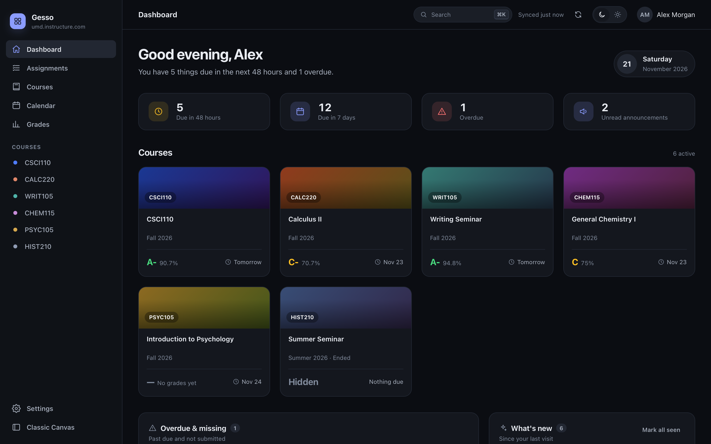
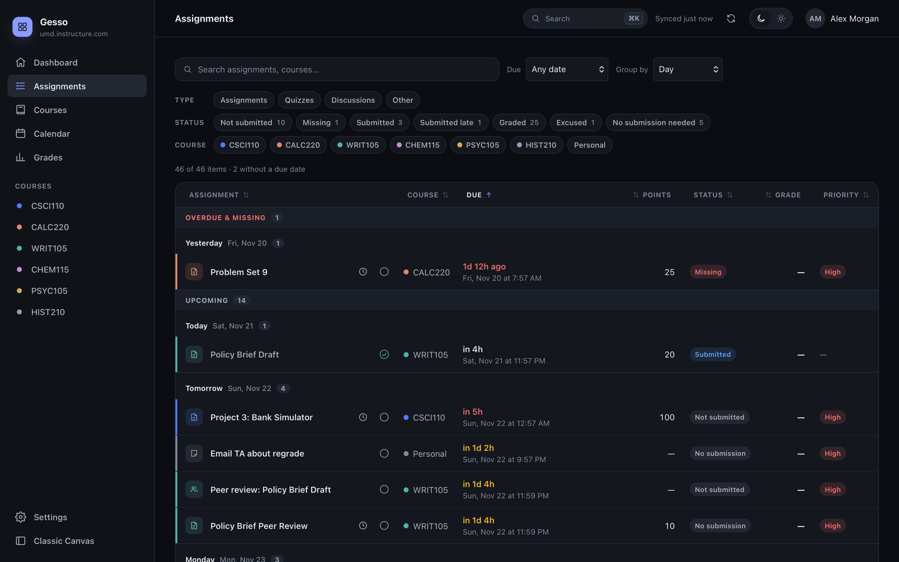
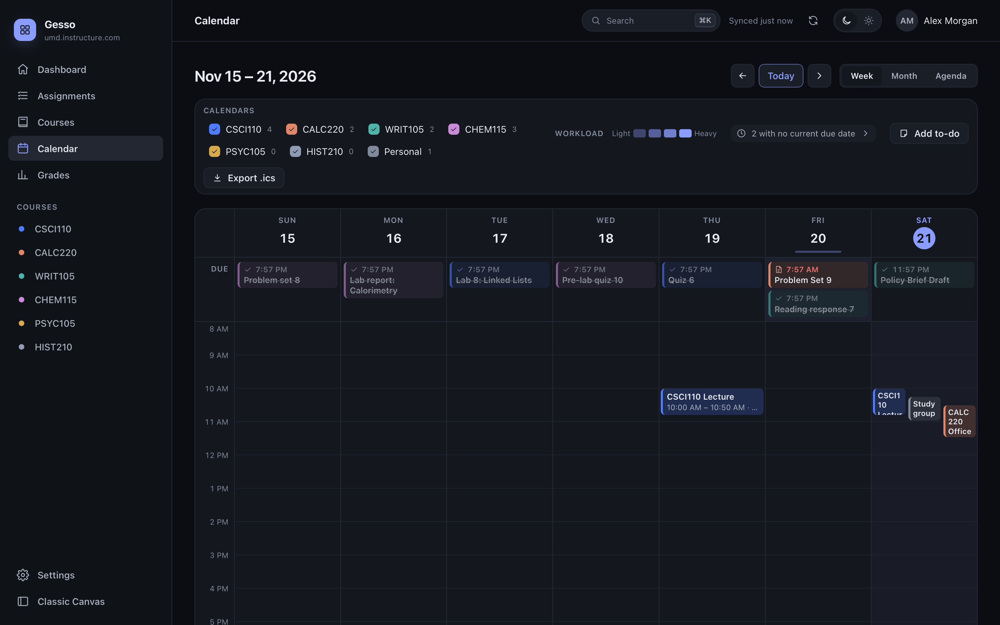
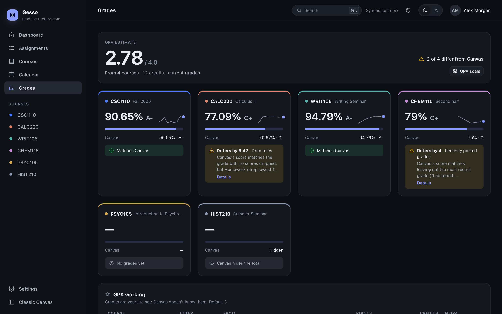
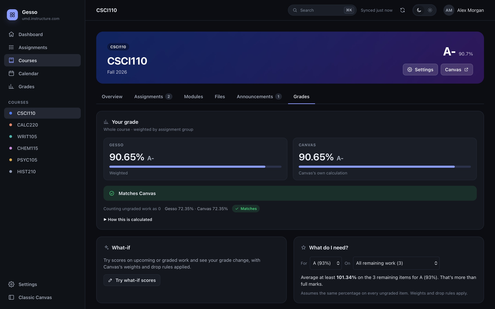
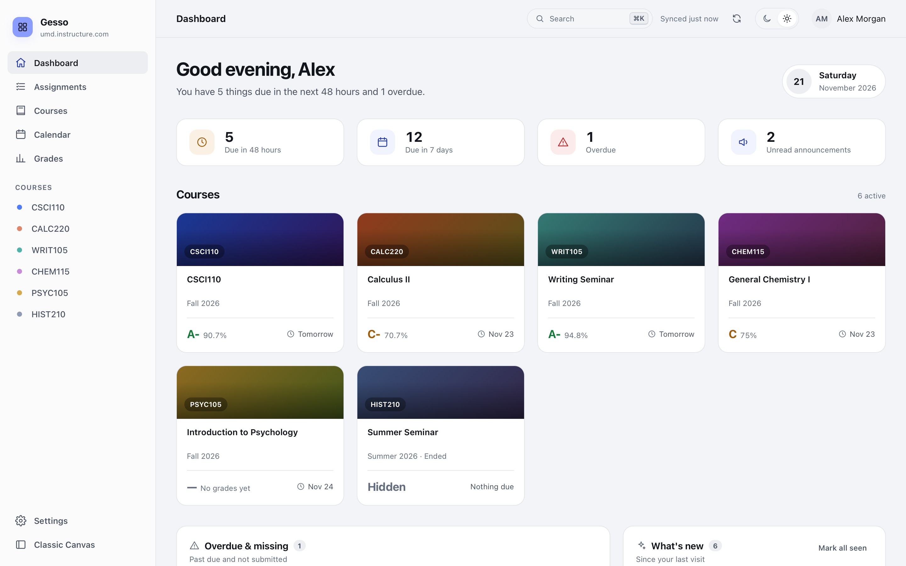
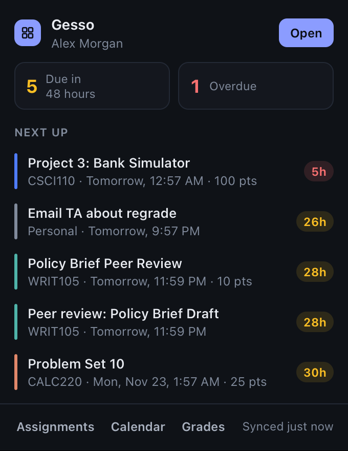
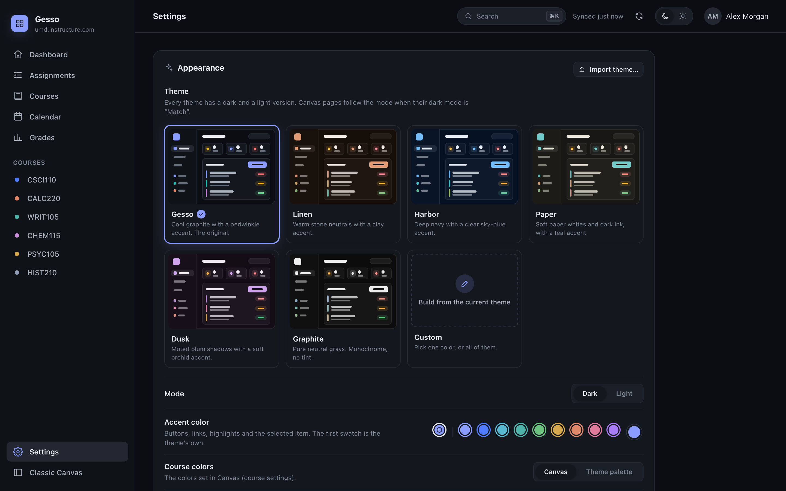
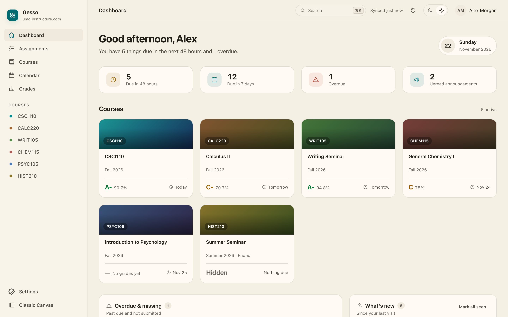

# Gesso

**An unofficial dashboard for Canvas.**

> Gesso is an unofficial project and is not affiliated with or endorsed by
> Instructure. Canvas is a trademark of Instructure, Inc.

Gesso is a Safari Web Extension for macOS. It replaces the Canvas LMS
dashboard with a faster, dark-first view that brings together the work from
all your courses. It also adds a dark theme to Canvas's own pages.

Everything runs on your Mac. Gesso calls the Canvas REST API from your Canvas
tab, using the login you already have. There are no tokens, no servers, no
analytics, no remote code and no dependencies.



| Assignment center | Calendar |
|---|---|
|  |  |
| **Grades, cross-checked against Canvas** | **A course's grade, with what-if and "what do I need"** |
|  |  |
| **Light theme** | **Toolbar popup** |
|  |  |
| **Themes: everyday, seasons and holidays, plus your own** | **The Paper theme, with its course palette** |
|  |  |

Screenshots use the built-in preview's made-up data.

## Contents

- [Features](#features)
- [Requirements](#requirements)
- [Build and install from source](#build-and-install-from-source)
- [Using it](#using-it) (including [Themes](#themes))
- [Privacy and permissions](#privacy-and-permissions)
- [Known limitations](#known-limitations)
- [How grades are calculated](#how-grades-are-calculated)
- [Development](#development)
- [Credits](#credits)
- [License](#license)
- [Trademarks](#trademarks)

## Features

- **Dashboard:**
  - due soon, overdue and missing work
  - course cards with grades and the next deadline
  - "What's new" since your last visit, and recent announcements
  - It paints from a local cache, then refreshes.
- **Assignment center:** every assignment, quiz, discussion, to-do and peer
  review from all courses in one sortable, filterable table. The default
  order is a timeline: overdue, then upcoming, undated, and past.
- **Course workspaces:** overview, assignments, modules, files,
  announcements and grades for each course, without leaving Gesso.
- **Assignment pages:** description, rubric, your submission, grade,
  comments and history.
- **Calendar:**
  - week, month and agenda views
  - deadlines, Canvas events and to-dos, color-coded by course
  - per-course filters, a workload heatmap and a "now" line
  - `.ics` export
- **Grades:**
  - Each course's grade is computed the way Canvas documents it: weights,
    drop rules, excused and unposted work.
  - It's cross-checked against Canvas's own number, and any difference is
    explained.
  - What-if scores, "what do I need" for each letter, trends, and a GPA
    estimate on a scale you choose.
- **Themes:** six everyday themes (Gesso, Linen, Harbor, Paper, Dusk,
  Graphite), four seasons and six holidays, each with a dark and a light
  version, plus your own custom theme. Optionally, Gesso changes with the
  seasons by itself. Pick one color and the rest is derived from it, or set the
  background, surfaces and text yourself. Optionally add a background image
  from your Mac. Themes can be shared as small `.json` files. They apply to
  Gesso and the toolbar popup. See [Themes](#themes).
- **Mark done, snooze and to-dos:** stored in Canvas itself (planner
  overrides and notes), so they also show in Canvas's planner and the mobile
  app. Every write is read back from Canvas before it counts as saved.
- **⌘K command palette:** jump to any course, assignment, page, file or
  action.
- **Keyboard shortcuts:** `g d` dashboard, `g a` assignments, `g c`
  calendar, `g g` grades, `g o` courses, `g s` settings. `?` lists them all.
- **Toolbar button:** a badge with the number of items due within 48 hours,
  and a popup with the next five.
- **Canvas's own pages:**
  - A dark theme that keeps photos and video in their real colors and also
    covers the rich text editor. You can turn it on or off per page type.
  - A floating **Gesso** button opens the page you're on in Gesso.
- **Accessibility:**
  - fully keyboard-navigable, with visible focus rings
  - WCAG AA contrast in every built-in theme, dark and light
  - respects "Reduce motion"
  - checked automatically on every view (see [Development](#development))
- **Submit from Gesso** (off by default): submit file uploads to an
  assignment without leaving Gesso. Gesso only says "Submitted" after
  re-reading Canvas and finding the new attempt with exactly your files.
  Text and website-URL submission is experimental (see
  [Known limitations](#known-limitations)).

## Requirements

- macOS with Safari 18 or later.
- Xcode, to build it (developed with Xcode 27.2). A free Apple ID signed
  into Xcode is enough.
- No Node.js, npm or bundler. The extension is plain JavaScript.

## Build and install from source

1. **Open** `xcode/Gesso/Gesso.xcodeproj` in Xcode.
2. **Signing:** select the project, then for **both** targets (*Gesso* and
   *Gesso Extension*):
   1. Go to **Signing & Capabilities**.
   2. Tick **Automatically manage signing** and choose your own team. A free
      Personal Team (your Apple ID) works.
3. **Bundle IDs:** `com.seawolf0.gesso` belongs to the author's team, so use
   your own, for example `com.yourname.gesso`:
   - the *Gesso* target's bundle identifier
   - the *Gesso Extension* target's bundle identifier, which must be the app's
     ID plus `.Extension`
   - `extensionBundleIdentifier` in `xcode/Gesso/Gesso/ViewController.swift`,
     which must match the extension's ID
4. **Your school's Canvas address:** Gesso is set up for
   `umd.instructure.com`. Open `extension/manifest.json` and change the
   domain in both places:
   ```json
   "host_permissions": ["https://YOURSCHOOL.instructure.com/*"],
   "content_scripts": [{ "matches": ["https://YOURSCHOOL.instructure.com/*"], ... }]
   ```
   Safari fixes these patterns at build time, so the domain can't be a
   runtime setting without asking for access to every site.
5. **Run:** choose the **Gesso** scheme and **My Mac**, then **Product → Run**
   (⌘R). A small app window opens. Its only job is to install the extension,
   so you can close it.
6. **Enable it in Safari:**
   1. **Safari → Settings → Extensions:** tick **Gesso**.
   2. Open your Canvas site. When Safari asks, choose **Always Allow on This
      Website**. You can also do this later from the toolbar button, or from
      **Settings → Extensions → Gesso → Edit Websites**.
   3. Optional: right-click the toolbar, choose **Customize Toolbar…**, and
      put the Gesso button where you want it.

Your Canvas dashboard now opens as Gesso. Other Canvas pages stay Canvas's
own, with dark mode and the floating **Gesso** button.

From the command line instead (after setting your team and IDs):

```sh
cd xcode/Gesso
xcodebuild -scheme Gesso -configuration Debug -allowProvisioningUpdates build
```

Then open the built app once (**Product → Show Build Folder in Finder**, then
`Products/Debug/Gesso.app`).

**Staying enabled after Safari quits:** Safari only keeps **signed**
extensions enabled. With automatic signing and any team, including a free
Personal Team, the build is development-signed and stays enabled.
- No provisioning profile is embedded on macOS, so the 7-day expiry of free
  iOS profiles doesn't apply.
- The "Apple Development" certificate lasts a year. When it renews, build and
  run once more.
- For a quick unsigned test only: **Safari → Settings → Developer → Allow
  unsigned extensions** (Safari resets it on quit; turn on **Show features
  for web developers** under Advanced first).

**After you edit code:** Xcode uses `extension/` in place. Run **Product →
Build** (⌘B), then reload the Canvas tab. New files under `extension/src/`
ship automatically, but content scripts must also be listed in
`manifest.json` (see [Development](#development)).

## Using it

- **Open Gesso:**
  - from the toolbar popup's **Open**
  - from your Canvas address
  - from the **Gesso** button on any Canvas page
- **Classic Canvas:**
  - `https://YOURSCHOOL.instructure.com/?gesso=classic` shows classic Canvas
    for one page load.
  - **Classic Canvas** in the sidebar switches over until you click **Use
    Gesso dashboard** on the classic dashboard.
- **Every view has its own address** (`…/#/assignments`,
  `…/#/courses/123/files`, …). Back, forward, reload and bookmarks return to
  the same place.
- **Mark done:** the circle on a row checks it off in Canvas's planner, with
  Undo.
- **Snooze:** the clock button hides an item until a day you pick. Canvas
  has no snooze, so Gesso saves a planner note linked to the item on that
  day, and Canvas's planner shows it as a reminder.
- **To-dos:** **Add to-do** on the dashboard or the calendar. They're Canvas
  planner notes, so they sync with Canvas and its apps.
- **Settings** (sidebar, or `g s`):
  - Appearance: theme, change with the seasons, mode, accent, course
    colors, decorations, density, and the custom theme editor (see
    [Themes](#themes))
  - Dashboard: default view, the "due soon" window
  - Grades: the GPA scale
  - Courses: courses hidden from Gesso
  - Canvas pages: the floating button, dark mode per page type
  - Submitting: "Submit from Gesso" (file uploads)
  - Experimental: text and website-URL submission
  - Data: clear the cache, reset settings
  - About
- **Keyboard:**
  - Safari's Tab key skips links unless you use **Option-Tab** or turn on
    **Safari → Settings → Advanced → "Press Tab to highlight each item on a
    webpage"**.
  - Turn on **System Settings → Keyboard → Keyboard navigation** so Tab
    reaches buttons too.
  - Gesso's own shortcuts (⌘K, `g` + letter, `?`) work regardless.

### Themes

**Settings → Appearance** shows a live preview of each theme, in three
groups: Everyday, Seasons and Holidays. Click one to switch, and use **Mode**
(or the sun and moon in the top bar) for its dark or light version.

- **Everyday themes:** Gesso (cool graphite, periwinkle; the original),
  Linen (warm stone, clay), Harbor (deep navy, sky blue), Paper (paper
  whites and ink, teal), Dusk (muted plum, orchid) and Graphite (neutral
  grays, monochrome). Every one passes the automated contrast audit (WCAG
  AA) in both modes.
- **Seasons and holidays:** Spring, Summer, Autumn and Winter, plus
  New Year's, Valentine's Day, Fourth of July, Halloween, Thanksgiving and
  Christmas. Each has a dark and a light version and its own palette (for
  example Halloween is deep charcoal with an ember accent; Christmas is deep
  evergreen with cranberry and gold). They pass the same contrast audit.
- **Change with the seasons** (off by default): Gesso shows the current
  holiday's theme during its window, otherwise the current season's, and
  says what's showing and what comes next. Turning it off (or picking any
  theme) brings your own theme back. It uses your Mac's date and changes over
  at midnight.
  - Seasons go by month: Spring March–May, Summer June–August, Autumn
    September–November, Winter December–February.
  - Holidays: New Year's Dec 27–Jan 2, Valentine's Day Feb 7–14, Fourth of
    July Jul 1–5, Halloween Oct 15–31, Thanksgiving from the Thursday before
    to the Sunday after (Thanksgiving is the fourth Thursday of November),
    Christmas from the Monday after Thanksgiving to Dec 26.
  - Your own accent color waits while it's on; seasonal themes keep theirs.
- **Seasonal decorations:** seasonal and holiday themes add one small,
  static line drawing (a sprig, a snowflake, a crescent moon…) in the
  sidebar's empty space and in the theme previews. It's never over your
  content. Turn it off with **Seasonal decorations**.
- **Accent:** the first swatch is the theme's own accent. Any other color
  replaces it, and links, focus rings and button text are adjusted to stay
  readable.
- **Course colors:** **Canvas** uses the colors set in Canvas. **Theme
  palette** gives courses the theme's own eight colors, in dashboard order.
  This only changes Gesso, never Canvas.
- **Custom theme:** **Build from the current theme** opens the editor.
  - Pick an **accent** and everything else follows: the grays take a faint
    tint of its hue, and the course palette is built around it.
  - Optionally set the **background**, **surface** and **text** for each
    mode. Secondary and muted text are mixed from your text color and kept
    readable. **Use auto** goes back to the derived color.
  - Course colors can be set per course. They stay on this Mac.
  - The editor checks contrast as you go and warns when any text drops
    below 4.5:1.
  - **Background image:** a PNG, JPEG or WebP from your Mac, with blur and
    dim. If the dim you choose would leave text below 4.5:1 over any part of
    the image, Gesso dims it more, and says so. The image is stored on this
    Mac (downscaled, re-encoded as JPEG), never loaded from the web.
  - **Reset to default** clears the colors, course colors and image.
- **Import and export:** **Export** saves the custom theme as a
  `.gesso-theme.json` file; **Import theme…** loads one, replacing your
  custom theme after asking. Files are checked strictly: only known keys,
  colors like `#14171e`, a size limit (8 MB), and at most one embedded PNG,
  JPEG or WebP image (no web addresses, no SVG). Anything else rejects the
  whole file. Per-course colors aren't exported, since they name your
  courses.
- Canvas's own pages keep their dark mode as before: it follows the mode
  (dark or light), not the theme's colors.

## Privacy and permissions

- **Network:** the only requests go from your Canvas tab to your Canvas
  server, using your existing session. The background script and the popup
  make no network requests. There are no external servers, analytics or
  remote code.
- **Stored on your Mac** (Safari's extension storage):
  - your settings, including your custom theme
  - your custom theme's background image, if you added one
  - a cache of your Canvas data, so Gesso paints instantly
  - a small summary for the toolbar popup

  **Settings → Data → Clear and reload** removes the cache. Removing the
  extension removes all of it. A few small mirrors of your mode and theme
  colors are also kept in your Canvas site's local storage, so the right page
  and colors can be shown before Canvas starts drawing.

**Permissions:**

| Permission | Why |
|---|---|
| Your Canvas domain (host) | Run on Canvas pages and call its API with your session |
| `storage`, `unlimitedStorage` | Settings and the local cache (large courses can exceed the 5 MB default) |
| `alarms` | Recount the toolbar badge every 5 minutes as items cross the 48-hour mark |

**What it writes to Canvas**, and only when you act. These are the same
settings Canvas's own pages and apps change:
- course nicknames, colors, and dashboard order
- marking announcements and discussions read
- planner overrides (mark done) and planner notes (to-dos, snoozes)
- **only if you turn on "Submit from Gesso" (files) or the experimental
  text/URL option, and press Submit:** the submission, with files uploaded
  through Canvas's normal upload into your submission files

It never changes grades.

## Known limitations

- **Text and website-URL submission from Gesso is experimental** and off by
  default (Settings → Experimental).
  - It hasn't been verified with a real submission yet. Submit those in
    Canvas for anything that matters. (File uploads, Settings → Submitting,
    are verified.)
  - Gesso only reports "Submitted" after re-reading Canvas and finding the
    new attempt with the right text or link.
- Media, annotations, quizzes and external tools always open Canvas.
- **Built and tested against one school's Canvas.** Other Canvas instances
  may use features or settings it hasn't met.
- **macOS Safari only.** There's no iOS/iPadOS or other-browser build.
- **Grades:**
  - Gesso always shows Canvas's own number next to its own. When they differ,
    it explains why where it can.
  - Weighted grading periods: when a course has grading periods but no
    current-period score, Canvas may combine periods by weight. Students
    can't see that setting, so Gesso can't reproduce it.
  - Anonymous grading: hidden posting of other students' submissions can
    affect Canvas's final score in ways Gesso can't see.
  - Rare drop-rule edge cases: 0-point assignments with scores inside a group
    with drop rules, and exact ties between equally good choices.
  - Letter grades use the course's scale when Canvas lets students read it.
    Otherwise they use Canvas's default scale and are labeled estimates.
  - Credits for the GPA are entered by hand. Pass/fail courses must be
    excluded by hand.
- **Calendar and planner:** ungraded to-dos and planner notes are only
  fetched for about three weeks back and four weeks ahead.
- Times use your Mac's time zone, not your Canvas profile's.
- **Dark mode on Canvas pages** doesn't reach content from other sites
  (New Quizzes, external tools, embedded video), or PDF previews unless
  "Dark PDFs" is on.
- Ungraded Canvas pages open in Canvas rather than in Gesso.
- The toolbar badge is only as fresh as the last sync from an open Canvas
  tab.

## How grades are calculated

Gesso's grade engine (`extension/src/content/data/grades.js`) is written
from public sources:

- Canvas's guides on how grades are calculated:
  - assignment group rules (drop lowest and highest, never drop)
  - weighting by assignment group
  - extra credit and excused work
  - excluding assignments from the final grade
  - posting policies
  - current vs. total grade
  - the default grading scheme
- The Canvas REST API documentation.
- *Dropping Lowest Grades* by Daniel M. Kane and Jonathan M. Kane,
  Mathematics Magazine 79(3), 2006. Drop rules use the paper's method: they
  keep the scores that give the best (or, for "drop highest", the worst)
  group percentage, not simply the lowest percentages.

Course scores use exact decimal arithmetic and are rounded half up to 2
decimals, so float error can't move a score across a boundary.

## Development

- **Preview without Canvas:** open `dev/preview/index.html` in Safari. It
  runs the real UI against made-up data (`dev/preview/mock-env.js`). URL
  parameters:
  - `?route=/courses/101/files` opens a view
  - `?theme=light`, `?latency=800`, `?fail=auth`
  - `?themeId=linen` starts with a built-in theme, `?courseColors=theme`
    with the theme's course colors
  - `?scale=20` gives 20× the assignments
  - `?noanim=1` for headless screenshots
- **Other previews:**
  - `dev/preview/popup.html`: the toolbar popup
  - `dev/preview/native.html`: a stand-in Canvas page for dark mode
- **Tests:** `dev/tools/test.sh` runs everything in headless WebKit
  (Safari's engine):
  - a syntax check of every script
  - unit tests (`dev/tests/tests.js`)
  - interaction checks (`dev/tests/ui-checks.js`)
  - never-blank checks (`dev/tests/health-checks.js`)
  - an accessibility audit of every view, the main dialogs and the custom
    theme editor, for every built-in theme in dark and light
    (`dev/tests/a11y-checks.js`)
  - the popup
  - dark-mode checks with pixel probes that confirm photos keep their colors

  Any failure fails the script.
- **Theme screenshots:** `dev/tools/theme-shots.sh [out-dir]` takes every
  built-in theme, dark and light, on every main view (plus the popup, a dialog
  and ⌘K), and makes a contact sheet per theme and one overview.
- **Headless runner options:** `--visible` runs CSS transitions and
  animations in real time (an on-screen, nearly transparent window), and the
  target can be an `http://` URL. `test.sh` serves the preview on localhost
  for the interaction checks, because the cross-tab settings ping
  (BroadcastChannel) needs a real origin.
- **Performance:** `dev/tools/perf.sh [scale]` prints the median and max
  render time per view. Run `test.sh` once first; it builds the headless
  runner.
- **Why no ES modules?** Safari loads content scripts as classic scripts.
  Each file is an IIFE that attaches its API to a shared `Gesso` namespace,
  in the order of the `js` array in `manifest.json`. When you add a content
  script, list it there and run `dev/tools/gen-preview-scripts.sh`
  (`test.sh` does this for you).

```
extension/                   The web extension (Xcode references this folder)
  manifest.json              Manifest V3; the Canvas domain is set here
  icons/
  src/
    shared/                  Namespace, config, settings, time, color, themes
    background/              Service worker: the toolbar badge (no network)
    popup/                   Toolbar popup (reads storage only)
    content/
      api/                   API client (pagination, throttling, CSRF) and endpoints
      data/                  normalize → cache → store → derive; sync, planner, grades, calendar, search
      ui/                    DOM helper, icons, styles, router, shell, palette, shortcuts, views/
      native/                Canvas's own pages: floating button, dark mode
      takeover.js            Replaces the dashboard route with Gesso
      main.js                Entry point (last in the load order)
xcode/                       macOS wrapper app that installs the extension
dev/                         Development only, not shipped: preview, tests, tools, icon sources
docs/screenshots/            The images in this README
```

## Credits

Most of the code was generated by Claude Opus 5.5 from prompts I designed and
refined. I tested every phase against live Canvas, found and diagnosed bugs,
directed every change, and made the design and security decisions.

The drop-rule method comes from Daniel M. Kane and Jonathan M. Kane,
*Dropping Lowest Grades* (Mathematics Magazine, 2006).

## License

Copyright (c) 2026 Sebastian Hardisty. All rights reserved.

The code is public so you can read it for reference. It may not be copied,
modified, or redistributed without permission. See [LICENSE](LICENSE).

## Trademarks

Gesso is an unofficial project and is not affiliated with or endorsed by
Instructure. Canvas is a trademark of Instructure, Inc. Gesso names Canvas
only to say what it works with.
